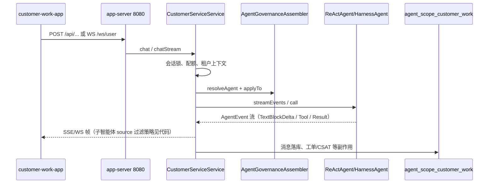

# 架构速览（留档用）

> 面向「快速吃透仓库」：模块边界、启动路径、主链路数据流。细节以 `README.md`、`docs/详细技术文档.md` 为准。

## 1. 模块一句话

| 模块 | 端口 | 干什么 |
|---|---:|---|
| `customer-work-starter` | — | Agent 基础设施（自动装配）：模型、记忆、RAG、工具、治理中间件、工单/审批等 SPI |
| `customer-work-app-server` | 8080 | 客服运行面：HTTP / SSE / WS、用户工单 |
| `customer-channel` | 8081 | 协议与渠道演示：OpenAI 兼容、AG-UI、Studio、钉钉/飞书/企微 |
| `customer-admin-server` | 8082 | 运营控制面：模型/Agent/MCP/发布/评测/工作台（库 `customer_admin`） |
| `customer-work-gateway` | 8888 | 可选网关（Nacos 路由 app/admin） |
| `customer-admin-web` | 5174 | 后台 Vue3 → 8082 |
| `customer-work-app` | 5175 | 用户 H5 → 8080（proxy） |

**硬约定**

- 建 `ReActAgent` 必须走 `AgentGovernanceAssembler.applyTo`，否则中间件只挂在部分链路上（项目历史复发点）。
- admin 访问客服库只走 `CustomerWorkFacade`，禁止直接复用 cw Mapper。

## 2. 本地启动路径（最短）

```text
依赖: MySQL(3306) + Redis(6379)；全量测试还需 MinIO(9000) 等，见 scripts/dev-health-check.sh

Java 17+
./scripts/dev-health-check.sh --strict

客服后端: customer-work-app-server (8080)
后台后端: ./scripts/run-admin-server-dev.sh  → 8082
后台前端: ./scripts/run-admin-web-dev.sh      → 5174
用户 H5:   customer-work-app npm run dev      → 5175
渠道演示:  customer-channel (8081)           → 非主链路必需
```

全量单测（本机 MySQL root/root，排除 Redis 密码不一致用例）：

```bash
export JAVA_HOME=$(/usr/libexec/java_home -v 17)
export ADMIN_MYSQL_PASSWORD=root
mvn -gs scripts/settings-central-direct.xml -s scripts/settings-central-direct.xml clean test \
  -Djacoco.skip=true -Dtest='!RedisSessionPersistenceTest' -Dsurefire.failIfNoSpecifiedTests=false
```

## 3. H5 一轮对话（主链路）



**同类入口（改能力时要一起核对）**

`chat()` / `chatStream()` / WS `/ws/user` / `/consult` 多 Agent / admin 工作台 / `customer-channel` / Harness。

## 4. 后台发布到运行面（控制 → 运行）

```text
admin-web → admin-server 保存配置/发起发布
         → RuntimePublishWorker + 门禁 + Outbox
         → Nacos（可选热更新，默认多为关闭）
         → app-server 消费租户运行时配置（缺配置时保留最后安全值）
         → CustomerWorkFacade 仅在 admin 需要读/写 cw 库时使用
```

## 5. 数据与状态落点

| 存储 | 典型内容 |
|---|---|
| `agent_scope_customer_work` | 会话、消息、工单、语义缓存、业务工具状态 |
| `customer_admin` | 用户权限、模型资产、Agent 配置、发布任务、账单 |
| Redis | 会话锁、限流、Sa-Token（admin 登录）、可选分布式计数 |
| MinIO | 附件原文件 |
| 框架 `agentscope_sessions` | Agent 会话状态（cw 库，部分由框架 DDL 自建） |

## 6. 读代码的推荐顺序

1. `AgentGovernanceAssembler` — 中间件全集与顺序  
2. `CustomerServiceService` — 客服入口与流式出站  
3. `ChatTurnService` — 轮次与转人工结算  
4. `CustomerWorkFacade` — admin 跨库边界  
5. `docs/功能与配置全量参考.md` — 配置项真相（Java 默认值 + 元数据）

## 7. 渠道 customer-channel（8081）

```text
IM 回调 (微信/钉钉/飞书) → Connector 解析为 ChannelInboundMessage
    → ChannelMessagePipeline (KeyedSerialExecutor 按 serialKey 串行)
    → AdminOpenApiClient / 本地 Agent → ChannelReplySender 回平台
微信: WeChatCallbackController → WeChatConnectorRegistry(appId) → 验签 + 防重放
```

演示能力（非主链路）：OpenAI 兼容 `/v1/chat/completions`、AG-UI、Studio，见 `docs/customer-channel操作文档.md`。

## 8. 网关 customer-work-gateway（8888）

| 路由 id | 前缀 | 后端 |
|---|---|---|
| `customer-admin-server` | `/admin/**` | StripPrefix=1 → admin 8082 |
| `customer-work-app-server` | `/app/**` | StripPrefix=1 → app 8080 |
| `customer-work-app-server-ws` | `/ws/**` | lb:ws:// app（不 StripPrefix） |

Nacos `namespace`/`group` 须与 app/admin 注册一致；离线验路由：`customer-work-gateway` 的 `GatewayRouteConfigTest`。

## 9. 脚本与清单

| 脚本 | 用途 |
|---|---|
| `scripts/dev-health-check.sh` | 本机依赖连通性 |
| `scripts/run-focused-tests.sh` | channel + gateway + 装配门禁快验 |
| `scripts/run-frontend-checks.sh` | 两前端 vitest + build |
| `scripts/pre-pr-grep.sh` | PR 前人工 grep |

审查清单：[代码审查与质量清单.md](代码审查与质量清单.md)

## 10. 与本文配套

- 本机依赖与常见假红：[本地排障速查.md](本地排障速查.md)  
- 15 分钟上手：[新人必读.md](新人必读.md)  
- AI 会话构建/测试坑：`CLAUDE.md`（仓库根）